# DrillDoc Intelligence

**An Experimental RAG System for Drilling Document Understanding**  
*Engineering documents, made searchable and explainable.*

> Experimental engineering project. It is not production-ready and is not an autonomous agent.

DrillDoc Intelligence explores how drilling and engineering PDFs can be converted into structured evidence, searched with lexical and semantic retrieval, and presented with source-linked answers. The project includes a FastAPI service, a static chat interface, configurable local model providers, and a synthetic evaluation set. It does not include operational drilling documents or model weights.

## Problem and approach

Technical PDFs mix prose, headings, tables, units, and page references. A useful retrieval system must preserve enough structure to find relevant passages and expose where an answer came from. This project implements a document-to-evidence pipeline and experiments with BM25, BGE-M3 semantic retrieval, reciprocal-rank fusion, reranking, and citation validation.

## Implemented capabilities

- PDF text extraction and structure/table detection.
- Normalization and hierarchical, table-aware chunking.
- Embedding and ChromaDB indexing.
- BM25, semantic, and hybrid retrieval with optional reranking.
- Evidence selection and context packing for configured local LLM providers.
- API and static chat interface with source citations.
- Synthetic fixtures and a 30-question retrieval/answer evaluation framework.

## Architecture and data flow

```mermaid
flowchart LR
    PDF[Authorized PDF input] --> EX[Extraction and structure detection]
    EX --> CH[Cleaning and structure-aware chunking]
    CH --> EMB[Embedding]
    EMB --> IDX[ChromaDB indexing]
    Q[User question] --> BM[BM25 retrieval]
    Q --> SEM[Semantic retrieval]
    IDX --> SEM
    BM --> HY[Hybrid RRF, when configured]
    SEM --> HY
    HY --> RR[Configured reranker, when enabled]
    BM --> SEL[Evidence selection and context packing]
    SEM --> SEL
    RR --> SEL
    SEL --> PB[Local provider boundary]
    PB --> LLM[Configured LLM, when available]
    LLM --> CV[Citation and answer validation]
    SEL --> CV
    CV --> API[FastAPI chat API]
    API --> UI[Static chat interface]
```

The diagram shows optional retrieval paths: BM25 and semantic results may be combined, and reranking depends on configuration. Answer generation requires a configured provider; retrieval and API health do not imply that an index or model is ready. See [architecture](docs/architecture.md) for module boundaries and readiness behavior.

## Technology

Python 3.11, FastAPI, Pydantic, PyYAML, pypdf/pdfplumber, sentence-transformers, PyTorch, ChromaDB, and local llama.cpp answer generation. Exact dependency resolution and fresh-install reproducibility remain unverified; see [setup](docs/setup.md).

## Setup overview

Create a Python 3.11 environment, install the project and the extras appropriate to your use case, then configure data/model directories outside the repository. The documented test/API, retrieval, and LLM paths have different prerequisites. Models are not bundled. Start with [setup instructions](docs/setup.md) and [data and model policy](docs/data-and-models.md).

## Synthetic evaluation

The measured benchmark used one small fictional engineering document and 30 annotated questions: 25 answerable and five unanswerable. Retrieval metrics below are macro-averaged over the 25 answerable questions; **retrieval metrics are not answer accuracy**.

| Method | Recall@5 | MRR | nDCG@5 |
|---|---:|---:|---:|
| BM25 | 0.96 | 0.80 | 0.8437 |
| BGE-M3 semantic | 1.00 | 0.94 | 0.9493 |
| Hybrid RRF | 1.00 | 0.86 | 0.8959 |
| Hybrid + reranker | 1.00 | 0.86 | 0.8959 |

Reranking did not improve measured top-five rankings. Answer-generation results are limited: strict normalized exact match was **0/25**; five answerable responses were downgraded to insufficient; all five unanswerable questions received verbal abstention, but their confidence remained medium. Citation precision was **0.752** and citation coverage **0.980**. No human faithfulness evaluation was performed. A separate single-question synthetic API smoke test produced a Llama answer with a matching source chunk; this does not change the benchmark results or establish general answer quality.

Full methodology, metrics, and limitations are in the [Phase 3.4 evaluation report](docs/evaluation-report.md) and [methodology](docs/methodology.md).

## Known limitations

The existing Conda environment passed **44/44 automated tests**. One real synthetic PDF-to-answer API test used local BGE-M3 embeddings and the Llama 3.1 8B GGUF model; its answer cited the expected source chunk and was displayed in the application frontend. This single smoke test does not establish general answer quality. A clean Python 3.11 installation was **not verified** because package-index TLS/authentication failed. See [setup](docs/setup.md) and the [latest evaluation report](docs/evaluation-report.md).

- Evaluation uses a single synthetic document and a small question set.
- The reranker showed no measured gain in this benchmark.
- Exact match, numeric checks, and citation provenance do not establish semantic faithfulness.
- Confidence calibration and human-rated answer faithfulness are unvalidated.
- Fresh installation and dependency locking are not verified.
- Model/runtime performance depends on local hardware and configuration.

## Future work

- Resolve and lock a supported dependency set; verify clean installation.
- Expand synthetic evaluation across document layouts and collections.
- Add human-rated faithfulness and claim-level citation support evaluation.
- Investigate numeric grounding and confidence calibration failures.
- Improve packaging and automated model-free CI coverage.

## Documentation

- [Architecture](docs/architecture.md)
- [Setup](docs/setup.md)
- [Data and models](docs/data-and-models.md)
- [Evaluation report](docs/evaluation-report.md)
- [Evaluation methodology](docs/methodology.md)
- [Security policy](SECURITY.md)
- [MIT License](LICENSE)
- Historical validation reports are retained in `docs/`; their current status is summarized in the latest evaluation report.

## Data and model policy

Only process documents you are authorized to use. Synthetic benchmark fixtures are included; original drilling documents, extracted content, indexes, databases, generated answers, evaluation traces, and model weights are not. Keep runtime data, caches, and traces outside the repository. See [data and models](docs/data-and-models.md) for storage and trace handling guidance.
