# Architecture

DrillDoc Intelligence is organized around document preparation, retrieval, and evidence-grounded answering. Retrieval branches are configurable; the API may start even when RAG is not ready.

```mermaid
flowchart LR
    PDF[Authorized PDF] --> EXT[Extraction and structure/table detection]
    EXT --> NORM[Normalization and hierarchical/table-aware chunking]
    NORM --> EMB[Embedding]
    EMB --> IDX[ChromaDB index]
    Q[Question] --> BM[BM25]
    Q --> SEM[Semantic retrieval]
    IDX --> SEM
    BM --> FUSE[Hybrid reciprocal-rank fusion, optional]
    SEM --> FUSE
    BM --> EVID[Evidence selection and packing]
    SEM --> EVID
    FUSE --> RERANK[Configured reranker, optional]
    RERANK --> EVID
    EVID --> BOUNDARY[Local LLM provider boundary]
    BOUNDARY --> LLM[Local Llama via llama.cpp]
    LLM --> VALID[Answer and citation validation]
    EVID --> VALID
    VALID --> API[FastAPI API]
    API --> UI[Static chat UI]
```

The indexing and query paths are separate: PDFs are extracted, normalized, chunked, embedded, and indexed before semantic retrieval can use the resulting ChromaDB index. BM25 and semantic results can be fused; reranking depends on configuration. The API's answer path uses the configured local Llama GGUF through llama.cpp. Citations are mapped to retrieved evidence and validated by the answering layer.

Backend responsibilities are separated into `extraction`, `chunking`, `indexing`, `retrieval`, `hybrid_retrieval`, `answering`, `chat`, `standards`, and `api`. Synthetic evaluation utilities live in `evaluation` and `scripts/evaluation`.

The API health endpoint reports liveness separately from RAG readiness. A missing compatible index or unavailable configured provider can leave chat unavailable while health remains inspectable. See [setup](setup.md), [data and models](data-and-models.md), and the [evaluation report](evaluation-report.md).
